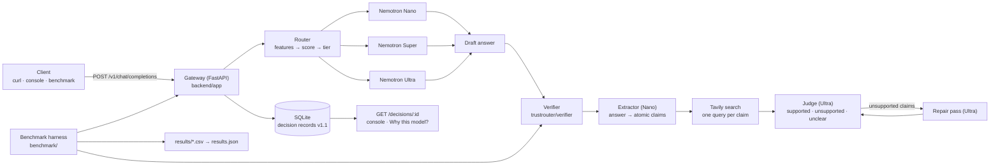

# TrustRouter

Route each prompt to NVIDIA Nemotron Nano, Super, or Ultra on Nebius Token Factory,
verify the answer's claims against web evidence, repair it on Ultra when a claim fails,
and record exactly what happened and what it cost.

Most "cheap model" routers optimise the one part of the bill that is already tiny. TrustRouter
measures the whole thing — generation, verification, and repair — and shows the trade-off
instead of asserting it.

## Architecture



The gateway is the only component that talks to the model APIs. The verifier is a separate
package the gateway loads through one seam (`TRUSTROUTER_VERIFIER=verify:verify`), so the same
checker serves the API and the benchmark, and a stub keeps the API honest when no verifier is
configured.

```
backend/                 FastAPI gateway (routing, verification seam, repair, records)
backend/app/pipeline.py  route → answer → verify → repair, the single decision path
backend/app/llm.py       call_llm(tier), retries, cost + latency accounting
backend/schema/          v1.1 decision-record contract, validated on every write
trustrouter/verifier/    claim extraction, Tavily search, judge, eval harness
benchmark/               prompt set, benchmark runner, results exporter
frontend/                React console (Ask, Hallucination Lab, Why this model?, Benchmark)
results/                 benchmark outputs (CSV, decision records, cache)
```

## Setup (5 steps)

1. **Configure.** `cp backend/.env.example backend/.env`, then set `NEBIUS_API_KEY`. Add
   `TAVILY_API_KEY` if you want real verification; without it every claim comes back
   `unclear`. Prices and model IDs are already in the example file.
2. **Install the gateway.**
   ```bash
   cd backend
   python -m venv .venv && .venv\Scripts\activate    # macOS/Linux: source .venv/bin/activate
   pip install -r requirements-dev.txt
   pip install "tavily-python>=0.5"                   # only needed for the real verifier
   ```
3. **Start the API.** `python -m uvicorn app.main:app --port 8000` from `backend/`.
   Add `TRUSTROUTER_MOCK_LLM=1` to the environment to run offline with no credits.
   Check `curl http://127.0.0.1:8000/healthz`.
4. **Start the console.** `cd frontend && npm install && npm run dev` → http://127.0.0.1:5173.
   It uses deterministic fixtures until you set `VITE_USE_MOCK=false` in `frontend/.env.local`.
5. **Prove it works end to end.** Ask a factual question in the console; the Why screen should
   show a claim list with sources, and `GET /decisions` should return the record.

Docker alternative: `cp backend/.env.example backend/.env`, fill in the key, then
`docker compose up --build` — the API on http://localhost:8000 and a placeholder console
page on http://localhost:5174. The image sets `TRUSTROUTER_VERIFIER=verify:verify` so real
verification is on when `TAVILY_API_KEY` is present in `backend/.env`. Build and start
verified on 25 Oct 2026, `/health` returns 200.

## Running the API

The gateway is OpenAI-compatible with two extra fields: `mode` (`fast` or `verified`) and
`model` (`auto`, `nano`, `super`, `ultra`).

```bash
curl -s http://127.0.0.1:8000/v1/chat/completions \
  -H 'content-type: application/json' \
  -d '{"model":"auto","mode":"verified",
       "messages":[{"role":"user","content":"When did the Berlin Wall fall?"}]}'
```

The reply carries a `gateway` block with `status`, `model_tier`, `decision_id`, integer
`supported_claims` / `unsupported_claims`, and `cost_usd`. The full record — route features
and confidence, every claim with its verdict, source URL and evidence snippet, the repair's
previous text, and the cost split into `base` / `verification` / `repair` — is at
`GET /decisions/{id}`. `stream=true` is rejected with 400, deliberately.

Statuses are `provisional` (fast mode, verification still running), `verified`, `repaired`,
`unchecked` (no usable verifier — never reported as verified), and `failed`.
Contract: [backend/schema/decision_record.schema.json](backend/schema/decision_record.schema.json)
and [backend/docs/api.md](backend/docs/api.md).

## Running the benchmark

```bash
cd "path/to/repo"                      # run from the repo root
python benchmark/run_benchmark.py --limit 8 --max-usd 0.50
python benchmark/export_results.py     # → frontend/public/results.json
```

The runner compares four strategies on the same prompts: `nano`, `super`, `ultra` (one direct
call each) and `trustrouter` (`run_pipeline(mode="verified")`, so its cost includes
verification and repair). Every graded answer is scored on Ultra against the prompt's
reference; for the three single-tier strategies the shared verifier also runs over the answer,
so `supported_claims_rate` is produced by the same checker everywhere. Both of those are
measurement and are never charged to a strategy.

It prints the number of calls and a cost estimate and waits for you to type `y` before spending
anything. `--max-usd` is checked before each call against that call's estimated cost.
Every `(strategy, prompt)` row is appended to `results/cache.jsonl` as it finishes, so a crash,
a cap stop, or a rerun never pays twice; a rerun reads cached rows for free.

Outputs in `results/`: `rows.csv` (one row per strategy × prompt, with the answer, grade,
supported rate, latency, cost, model, status, and whether it escalated or repaired),
`summary.csv`, `failures.csv` (TrustRouter rows graded incorrect, with their claims),
`records.jsonl` (the decision record behind each TrustRouter row), and `cache.jsonl`.

The verifier can also be scored against hand-labelled claims:
`python trustrouter/verifier/eval_verifier.py` reads
`trustrouter/verifier/labeled_claims.jsonl` and reports agreement, a confusion matrix, and
false-alarm and miss rates.

## How Nemotron and Nebius Token Factory are used

- **Nano** (`nvidia/NVIDIA-Nemotron-3-Nano-30B-A3B`) answers short/low-risk prompts and is the
  extractor that turns an answer into atomic claims. Cheap and fast, which matters because
  claim extraction runs on every verified answer.
- **Super** (`nvidia/nemotron-3-super-120b-a12b`) answers prompts that need code, multi-step
  work, or factual care but not full reasoning depth.
- **Ultra** (`nvidia/Nemotron-3-Ultra-550b-a55b`) answers the hardest prompts, judges every
  claim against the evidence, and performs the single repair pass when a claim is unsupported.

The router in `backend/app/router.py` scores length, reasoning markers, code, and factual-risk
signals, picks a tier, and escalates one tier when confidence is below the floor. Every
routing decision is stored with its features, so a tier choice can be explained after the fact.

**Where Token Factory helped:** one OpenAI-compatible endpoint serves all three tiers, so the
router only swaps a model ID — no second client, key format, or SDK. All three IDs came from
the catalog (`backend/list_models.py` prints which `.env` values are missing from the live
list, which is how the sealed IDs were confirmed rather than guessed), and the per-tier prices
published there feed the cost math directly (nano 0.06/0.24, super 0.30/0.90, ultra 1.00/3.00
USD per 1M tokens). Because pricing is per model, the cost of a decision is measurable rather
than estimated, which is what makes the benchmark meaningful.

## Tavily

Verification searches the web once per claim. The query is the claim text itself (trimmed to
380 characters), Tavily returns three results, and each snippet is capped at 500 characters
before it reaches the judge. Search is best-effort: a missing key, a timeout, or an HTTP error
returns no evidence and the claim becomes `unclear`, so a search outage degrades the verdict
rather than failing the request. At $0.008 per search, Tavily is the largest single line in
verification cost — larger than the models — which is why the benchmark reports verification
spend separately from token spend.

## Results

Run `python benchmark/run_benchmark.py` then `python benchmark/export_results.py` and fill these
in from `results/summary.csv`. Nothing below is pre-filled on purpose — no result in this
repository should be a number nobody measured.

Measured on 5 factual_easy prompts only. Harder categories (factual_hard, fake_entity,
false_premise) are not yet run.

| Strategy | Accuracy | Supported-claim rate | Avg cost / prompt | p50 latency | p95 latency | Repair rate |
| --- | --- | --- | --- | --- | --- | --- |
| Always Nano | not yet measured | not yet measured | not yet measured | not yet measured | not yet measured | not yet measured |
| Always Super | not yet measured | not yet measured | not yet measured | not yet measured | not yet measured | not yet measured |
| Always Ultra | not yet measured | not yet measured | not yet measured | not yet measured | not yet measured | not yet measured |
| TrustRouter | not yet measured | not yet measured | not yet measured | not yet measured | not yet measured | not yet measured |

Prompt mix: 40 prompts — 8 easy facts, 8 hard facts, 8 plausible-but-fake entities, 6 false
premises, 6 short reasoning problems, 4 plain chat prompts (ungraded). Accuracy is computed on
graded prompts only, and only over prompts every strategy completed.

## Known limitations

- **Same-family judging bias.** The judge is Nemotron Ultra scoring Nemotron answers. A model
  family asked to grade its own output tends to be lenient about phrasing it would have
  produced, and harsh about answers that disagree with it. A cross-family judge would be the
  fix; we did not have one wired up.
- **Search-based verification can miss false claims.** The judge sees only three snippets and
  is instructed to decide from those alone. A claim that is false but not contradicted by the
  retrieved snippets lands on `unclear` — deliberately never `supported`, but also never
  caught as wrong. Absence of evidence is not evidence of absence.
- **Rules cannot detect a false premise.** Routing and verification are lexical and
  claim-level: if a question assumes something untrue ("why did Newton win the Nobel Prize?"),
  the answer may contain no individually false claim, and nothing in the pipeline rejects the
  premise itself.
- **Verification dominates cost.** At one search per claim, checking an answer can cost more
  than generating it, so a cheap-tier answer with verification can be pricier than an Ultra
  answer without it. The benchmark reports both figures rather than hiding it.
- **The extractor can return nothing for a long answer.** Those answers are now reported
  `unchecked` instead of `verified`, and the raw extractor output is appended to
  `backend/logs/extractor_failures.jsonl` — but the answer still went unchecked, and the log
  is the only trace of why.
- **Fast mode is in-process.** Verification runs in a background task, so a restart can leave
  a record `provisional`; the console polls with a timeout.

## What was built during the submission period

- **Gateway** (`backend/app`): OpenAI-compatible endpoint with `mode`/`model` extras, a
  feature-based router, a verification seam with a stub that refuses to look verified, one
  bounded Ultra repair pass with re-verification, SQLite persistence, schema validation on
  every write, cost/time accounting, and structured logging with no prompt text.
- **Verifier** (`trustrouter/verifier`): claim extraction, concurrent Tavily search per claim,
  a judge prompt hardened so absence of evidence is `unclear` rather than `unsupported`, cost
  accounting, and a hand-labelled evaluation harness reporting a confusion matrix plus
  false-alarm and miss rates.
- **Console** (`frontend`): React/Vite app with Ask, Hallucination Lab (one prompt, three
  tiers), Why this model? (the stored record: routing evidence, economics, claim sources, raw
  JSON), and a Benchmark view.
- **Benchmark** (`benchmark`): a 40-prompt set across six categories, a runner that compares
  four strategies with per-row caching, a spend cap and a cost estimate, grading on a
  reference answer, and an exporter that publishes `frontend/public/results.json`.
- **Packaging**: `Dockerfile`, `docker-compose.yml`, and `.dockerignore` so the API starts with
  `docker compose up` while keys stay in `backend/.env`.

## License

MIT — see [LICENSE](LICENSE).
